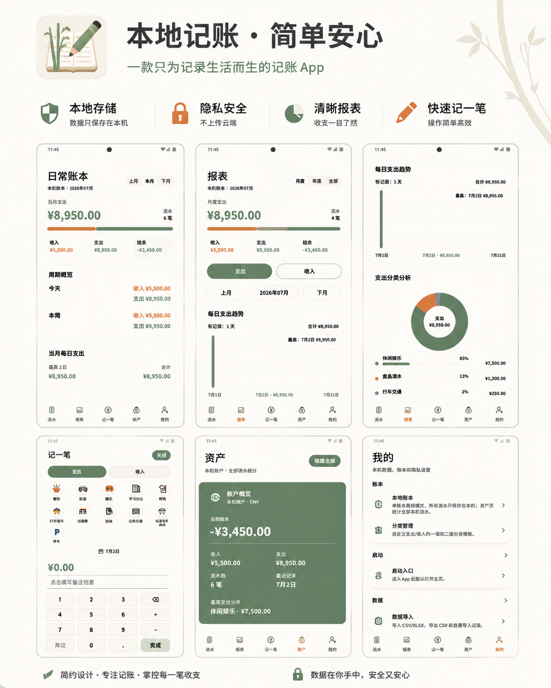

# 竹简



竹简是一款面向个人使用的 Android 离线记账 App。它把重点放在日常记账、数据查看和本地数据管理上，不做账号体系、云同步或在线服务，适合希望把账本留在自己手机里的用户。

## 特色

- 简约：界面围绕“记一笔、流水、报表、我的”展开，入口清晰，减少不必要的干扰。
- 实用：支持支出、收入记录，一级/二级分类管理，月度、年度和总计报表，本地资产概览。
- 隐私：APK 不申请联网权限，数据导入、导出和备份都通过 Android 系统文件选择器在本机完成。
- 安全：支持四位数字密码、系统生物识别、本地备份与加密备份，适合保存个人账本数据。

## 主要功能

- 手工记账：记录支出、收入、一级/二级分类、时间和备注。
- 分类管理：内置常用收支分类，支持一级/二级分类的新增、改名和删除。
- 流水管理：查看、编辑、删除本地账单记录，可按分类、备注或账户搜索。
- 报表统计：按月度、年度、总计查看收支趋势、支出分类占比（环形图）和当月每日支出（柱状图）。
- 资产概览：以本地账户口径汇总收入、支出和余额。
- 数据导入：支持 CSV/XLSX 表格导入，按关键词自动识别分类；同一表格中的重复行会跳过，未识别的分类会在导入结果中提示。
- 数据导出：支持导出 CSV，便于用表格软件查看或二次整理。
- 本地备份：支持导出和恢复备份包，导入前会自动创建本机备份。
- 本地安全：支持本地锁和系统生物识别，降低他人直接查看账本的风险。
- 外观主题：跟随系统自动切换浅色 / 深色主题。

## 下载

当前版本 APK：

- 官方下载：[zhujian-rn-v1.4.15.apk](https://github.com/netkr/zhujian/releases/download/v1.4.15/zhujian-rn-v1.4.15.apk)
- 国内加速备用：[ghfast.top](https://ghfast.top/https://github.com/netkr/zhujian/releases/download/v1.4.15/zhujian-rn-v1.4.15.apk)

加速链接由第三方代理提供，仅用于公开 APK 下载。如果链接失效，请优先使用官方下载。

## 隐私说明

竹简的设计目标是本地优先：

- 不需要注册账号。
- 不申请 `android.permission.INTERNET`。
- 不上传账本数据。
- 不依赖云端同步。
- 导入、导出、备份、恢复均由用户主动选择本机文件完成。

请妥善保管自己的备份文件和备份密码。忘记本地数字密码或加密备份密码后，应用无法代为找回。

## 适用场景

- 想要一个简单、干净的个人记账工具。
- 不希望账本数据上传到云端。
- 需要从 CSV/XLSX 表格迁移历史账单。
- 希望能随时导出或备份自己的账本数据。

## 项目状态

仓库包含竹简的源码与项目说明，源码基于 React Native（Expo）开发。APK 安装包随 GitHub Releases 发布，不放入代码仓库。

## 从源码构建

需要 JDK 与 Android SDK。

```bash
npm install
./scripts/build-android.sh        # 默认构建 release APK
```

`scripts/build-android.sh` 通过环境变量 `JAVA_HOME` 定位 JDK，也可在 `scripts/.local.env` 中配置（该文件不纳入版本控制）。release 签名读取 `release-signing.properties`，该文件不包含在仓库中，需自行准备。
